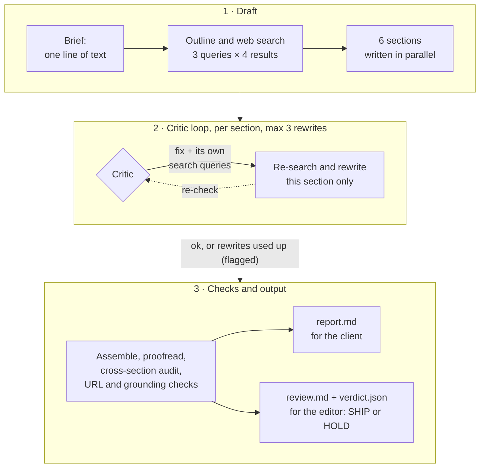

**English** · [Русский](README.ru.md)

[](https://github.com/kirmskhq/agentic-research-pipeline/actions/workflows/tests.yml)
[](LICENSE)
[](https://www.python.org/)

# Agentic market-research pipeline

Turns one line of text — "a local dog-walking service, Telegram WebApp" — into a
six-section market report grounded in live web search, and then checks its own work and
tells the human editor where to look before the report goes to a paying customer.

This is the generalized version of a pipeline that ran in production as a paid product:
customers paid by card, the report was generated automatically, and an editor read every
report before it was sent. The pipeline does not replace that read; it makes it faster by
pointing at the weak spots. The repo keeps the machinery and drops the billing integration.

## What it produces

A markdown report with six fixed sections (in Russian, the market it was built for):

1. The field and its key terminology
2. Existing players (domestic + 2–3 global)
3. Pricing and monetization models
4. Customer profile and what they use today
5. Unserved segments and market gaps
6. Positioning recommendations

Sections 2–5 are written against live search results and cite their sources as markdown
footnotes, numbered once across the whole report. Next to the report the run writes review
notes for the editor — verdict, unresolved issues, dead links, footnotes that came from the
model rather than from search — as `review.md` and `verdict.json`. The client report itself
carries none of it.

A real run, with the editor's notes, is in [`examples/dog-walking/`](examples/dog-walking/).

## Pipeline



## The three things worth looking at

**1. The loop is per-section, and it exits on merit, not on a counter.**
The naive version critiques the whole report once and rewrites the whole report once — one
pass, no verification that the rewrite fixed anything. Here each section is judged on its own
and only the failing ones are rewritten; a section leaves the loop the moment its critic
returns `ok`. Every rewrite, the last one included, goes back to the critic before the
section counts as fixed. `RESEARCH_MAX_CRITIC_ROUNDS` caps the rewrites; it is a safety
stop, not the exit condition. That
distinction matters: the cheap sections stop burning tokens early, and a stubborn section is
visible as a fact rather than hidden inside an averaged "the report was revised once".

**2. The critic chooses to use a tool, and writes the arguments itself.**
When a section fails because a claim has no source, the critic does not just complain — it
returns its own search queries:

```json
{"verdict": "fix",
 "issues": ["«около 40% пользователей» — процент без источника"],
 "search_queries": ["сервис выгула собак доля рынка 2026", "выгул собак статистика россия"]}
```

Those queries are run against DuckDuckGo and the results are appended to that section's
context before it is rewritten. This is the one place where the model, not the script, decides
that a tool is needed and with what arguments — everything else in the pipeline is a fixed
sequence, and the README would rather say so than oversell it.

**3. The run ends in review notes for the editor, not in a delivery.**
A person reads every report before it goes out; the pipeline's job is to tell that person
where to look. Deterministic checks (sections that never passed, missing or too-short
sections, dead footnote URLs, footnotes whose domain never appeared in any search result,
cross-section contradictions) are combined with an editor model's judgement into `review.md`
and `verdict.json`. `HOLD` means "read this one closely": it is also printed to stderr,
optionally written to `$RESEARCH_VERDICT_FILE`, and returned as **exit code 3**, so a calling
system can put that report at the top of the queue. The editor opens a report already knowing
which section failed review and which footnotes are unverified, instead of re-checking
everything by hand.

## Is this "agentic"?

Partly, and the honest answer is more useful than the buzzword:

| Property | Here |
|---|---|
| Multi-step plan with specialized roles (writer / critic / fixer / editor) | yes |
| Retrieval grounding with citations, plus a check that citations came from retrieval | yes |
| Self-evaluation that changes control flow (loop exits on the judge's verdict) | yes |
| Model-chosen tool invocation with model-authored arguments | yes, in one place (re-search) |
| Model-chosen *plan* — deciding the order of stages, or skipping them | no, the sequence is fixed |
| Open-ended tool catalogue the model picks from | no, one tool: web search |
| Memory across runs | no, every run starts cold |

So: an evaluator–optimizer workflow with one real tool-choice point and a quality gate — not
an autonomous agent, and it does not need to be one to be worth money.

## Running it

```bash
cp .env.example .env    # add LLM_API_KEY (any OpenAI-compatible endpoint)
docker build -t research-pipeline:latest .
./run.sh "локальный сервис выгула собак" > report.md; echo "exit=$?"   # 0 = nothing flagged, 3 = hold
# report.md, review.md and verdict.json are also in reports/<timestamp>/
```

Without Docker: `pip install "openai==2.38.0" "ddgs==9.14.4"` and
`python pipeline.py "..." --out reports/dog-walking` (or `> report.md`, and the review notes
go to stderr).

Defaults point at Yandex AI Studio with DeepSeek V3.2 (that is what production used, for
Russian-language quality and domestic hosting); set `LLM_BASE_URL` and `LLM_MODEL` for OpenAI,
DeepSeek direct, OpenRouter, or a local vLLM. If the provider caps simultaneous requests
(free tiers often allow 3), set `LLM_MAX_CONCURRENCY` to that cap: calls then queue instead
of failing with 429.

## Tests

```bash
python tests/test_pipeline.py
```

The same suite runs in GitHub Actions on every push and pull request.

Fourteen checks run offline — no API key, no network, no LLM — by substituting scripted critic
verdicts:

```
PASS | all sections pass first round: verdict=SHIP searches=12
PASS | critic orders a re-search, then passes: verdict=SHIP searches=14
PASS | section never passes → hold: verdict=HOLD critic={2: 4} fix={2: 3}
PASS | last rewrite is re-checked and passes: verdict=SHIP critic={2: 4} fix={2: 3}
PASS | garbage critic answer → treated as fix: verdict=SHIP
PASS | editor gate says hold: verdict=HOLD reasons=['редактор: цифры выглядят выдуманными']
PASS | footnotes unique across report: defs=['1', '2', '3', '4', '5', '6']
PASS | renumber_footnotes maps per section
PASS | footnote definitions listed in order
PASS | footnote_defs reads both url forms
PASS | review notes kept out of the client report
PASS | bot-blocked links are not dead links
PASS | LLM concurrency capped: peak=3 of 10 calls, cap=3
PASS | search budget caps extra searches: verdict=SHIP searches=14
```

The garbage-critic case is the one that matters in review: an unparseable critic answer is
treated as a failed section, never as a silent pass. Fail-closed, not fail-open. The
last-rewrite case guards the other direction: a section is never held just because its final
rewrite went unchecked.

## Cost and latency

One report is roughly 25–40 LLM calls and 12–20 search queries. End-to-end runtime in
production was 17–35 minutes for the same brief — the spread comes from the provider, not
from the loop; the loop adds one critic call per section per round. Budget for the worst case,
not the average, if you promise a turnaround.

## Known limits

- No caching between runs; identical briefs pay full price twice.
- Search is search-result snippets only — pages are never fetched, so a fact that lives in the
  body of an article is invisible to the model.
- The critic and the writer are the same base model, which caps how much the critique can
  catch; a different (or larger) model as critic is the obvious next experiment.
- Section order and count are fixed; a brief that deserves a different shape of report will not
  get one.
- Russian-language prompts throughout — translating them is mechanical but not done here.

## Roadmap

- [x] A real sample run in [`examples/dog-walking/`](examples/dog-walking/), with its `review.md` and `verdict.json`
- [ ] Cross-encoder rerank of search results before they enter the prompt
- [ ] Per-section cost/latency telemetry in `verdict.json`
- [ ] Critic model separate from writer model

MIT licensed.
